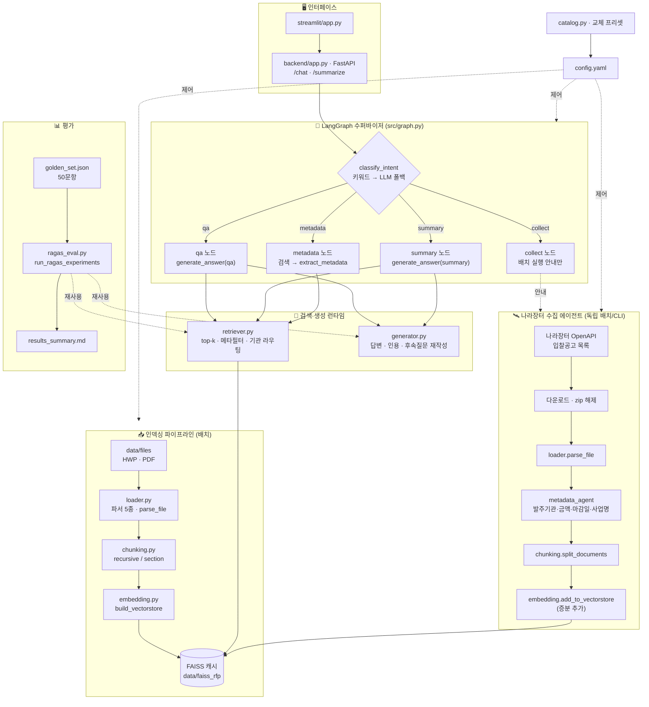
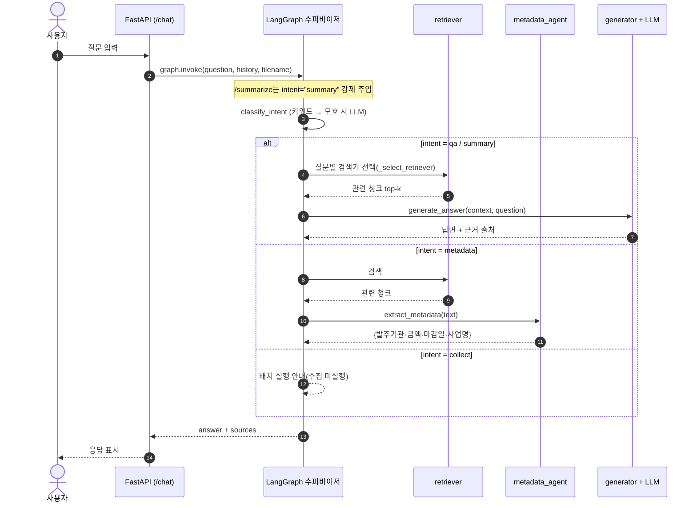

# 시스템 아키텍처

> 입찰메이트 — RFP RAG 질의응답 시스템 · 기준 브랜치 `limdongkyu`
> 💡 아래는 Mermaid 다이어그램 — GitHub·VS Code 미리보기에서 자동 렌더링됩니다.

## 전체 구조



## 질의응답 흐름 (LangGraph 라우팅)



## 컴포넌트 요약

| 레이어 | 파일 | 역할 |
|---|---|---|
| 설정 | `config.yaml`, `src/catalog.py` | 교체 축(임베딩·LLM·청킹·검색·파서) 스위치 + `nara` 섹션 |
| 파싱 | `src/loader.py` | HWP(pyhwp·hwp-hwpx-parser·olefile) / PDF(pymupdf·pdfplumber) · `parse_file`(단일 파일) |
| 청킹 | `src/chunking.py` | recursive / section(키워드 섹션) |
| 임베딩 | `src/embedding.py` | FAISS 캐시(`build_vectorstore`) + 증분 추가(`add_to_vectorstore`) |
| 검색 | `src/retriever.py` | top-k + 메타데이터 필터 + 기관 자동 라우팅 |
| 생성 | `src/generator.py` | 답변 + 인용(citation) 정제 + 후속질문 재작성 |
| **오케스트레이션** | `src/graph.py` | **LangGraph 수퍼바이저: 의도 분류 → qa/summary/metadata/collect 라우팅** |
| **에이전트** | `src/agents/metadata_agent.py`, `src/agents/nara_agent.py` | 메타데이터 LLM 추출 · 나라장터 공고 수집(독립 배치/CLI) |
| 인터페이스 | `backend/app.py`, `src/streamlit/app.py` | FastAPI API · Streamlit UI |
| 평가 | `src/evaluation/ragas_eval.py`, `run_ragas_experiments.py` | 골든셋 18조합 RAGAS + 커스텀 지표 |

## 의도 라우팅 (수퍼바이저)

| 의도 | 트리거(키워드 우선·모호 시 LLM) | 동작 |
|---|---|---|
| `qa` | 기본값 | 검색 → `generate_answer(qa)` |
| `summary` | "요약/정리/개요" · `/summarize`는 강제 | 검색 → `generate_answer(summary)` 고정 양식 |
| `metadata` | "메타데이터/기본 정보 추출" | 검색 → `metadata_agent.extract_metadata` |
| `collect` | "신규 공고/공고 수집/나라장터…수집" | 수집 미실행, 배치 실행 방법 안내 |

## 나라장터 수집 (독립 배치/CLI)

```bash
python -m src.agents.nara_agent              # 당일 수집
python -m src.agents.nara_agent 2024-04-09   # 특정 날짜
python -m src.agents.nara_agent 2024-04-09 --max 5   # 건수 제한
```

- 환경변수 `NARA_API_KEY`(공공데이터포털 발급) 필요 — `.env`에 저장
- 수집 산출물: `data/nara_seen.json`(중복 방지), `data/nara_downloads/`(첨부)
- 수집 문서는 `add_to_vectorstore`로 기존 FAISS에 증분 추가되어 이후 질문에서 검색됨

## 교체 가능 부품 (catalog 프리셋)

| 축 | 옵션 |
|---|---|
| LLM | gpt-5-nano · gpt-5-mini · exaone3.5:7.8b(Ollama) · qwen2.5:14b(Ollama) |
| 임베딩 | OpenAI 3-small · KURE-v1(로컬) · BGE-M3(로컬) |
| 청킹 | recursive 300/500/1000 · section 500/1000 |
| 파서 | HWP: pyhwp·hwp-hwpx-parser·olefile / PDF: pymupdf·pdfplumber |
| 검색 | k, 메타데이터 필터, (옵션) BM25·리랭커 |
