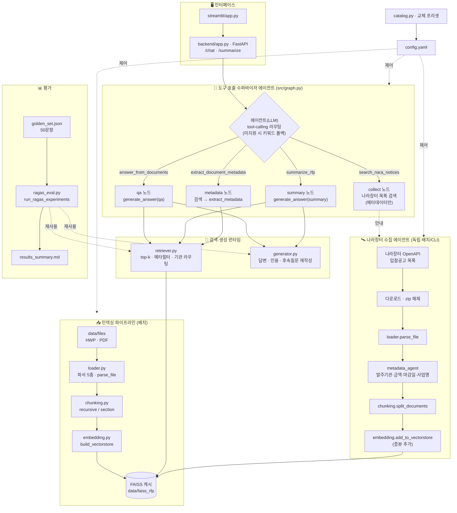
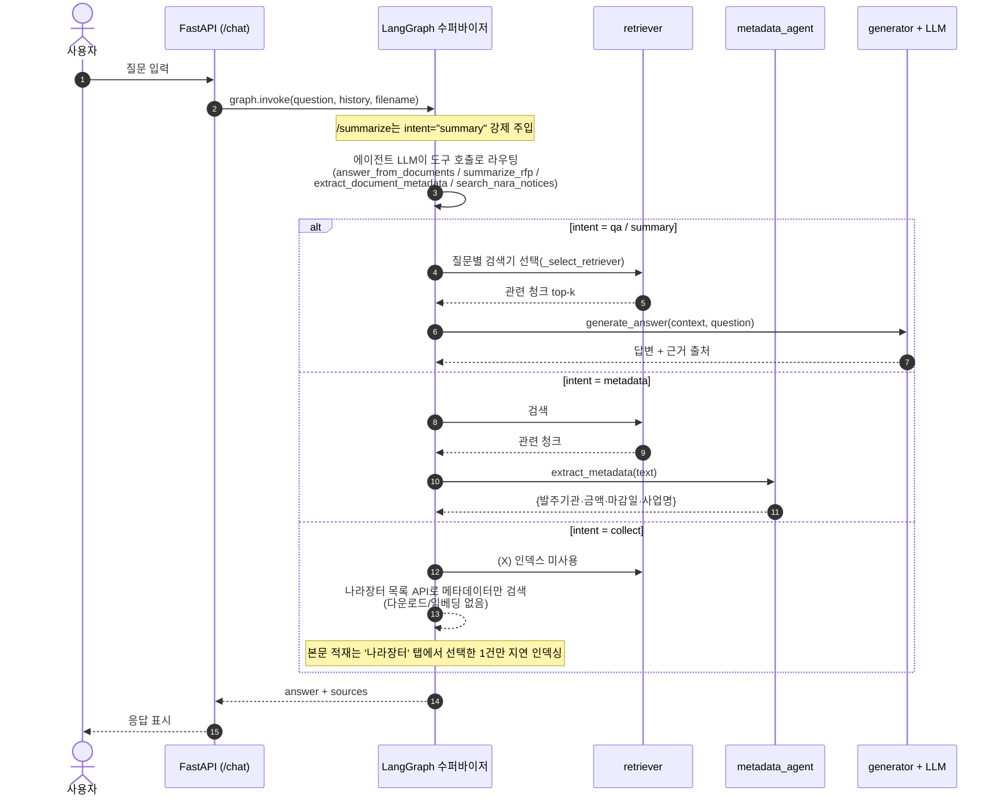

# 시스템 아키텍처

> 입찰메이트 — RFP RAG 질의응답 시스템 · 기준 브랜치 `limdongkyu`
> 💡 아래는 Mermaid 다이어그램 — GitHub·VS Code 미리보기에서 자동 렌더링됩니다.

## 전체 구조

## 질의응답 흐름 (LangGraph 라우팅)

## 컴포넌트 요약

| 레이어 | 파일 | 역할 |
|---|---|---|
| 설정 | `config.yaml`, `src/catalog.py` | 교체 축(임베딩·LLM·청킹·검색·파서) 스위치 + `nara` 섹션 |
| 파싱 | `src/loader.py` | HWP(pyhwp·hwp-hwpx-parser·olefile) / PDF(pymupdf·pdfplumber) · `parse_file`(단일 파일) |
| 청킹 | `src/chunking.py` | recursive / section(키워드 섹션) |
| 임베딩 | `src/embedding.py` | FAISS 캐시(`build_vectorstore`) + 증분 추가(`add_to_vectorstore`) |
| 검색 | `src/retriever.py` | top-k + 메타데이터 필터 + 기관 자동 라우팅 |
| 생성 | `src/generator.py` | 답변 + 인용(citation) 정제 + 후속질문 재작성 |
| **에이전트** | `src/graph.py` | **도구 호출 수퍼바이저: LLM이 도구를 선택·호출해 라우팅** |
| **도구(tool)** | `metadata_agent`, `nara_agent`, `retriever`, `generator` | 에이전트가 호출하는 능력 — 메타데이터 추출 · 나라장터 검색 · 검색 · 답변생성 |
| 인터페이스 | `backend/app.py`, `src/streamlit/app.py` | FastAPI API · Streamlit UI |
| 평가 | `src/evaluation/ragas_eval.py`, `run_ragas_experiments.py` | 골든셋 18조합 RAGAS + 커스텀 지표 |

## 도구 호출 라우팅 (에이전트 + 도구)

수퍼바이저 **에이전트**(LLM)가 요청을 보고 **도구**를 하나 골라 호출한다. 도구 인자(검색어 등)도
LLM이 채운다. 도구 호출을 지원하지 않는 LLM(일부 Ollama)은 키워드 휴리스틱으로 폴백한다.
`/summarize`는 분류 없이 summary 도구를 강제한다.

| 도구(LLM에 노출) | 노드 | 동작(도구 본체) |
|---|---|---|
| `answer_from_documents(question)` | qa | 검색 → `generate_answer(qa)` |
| `summarize_rfp(query)` | summary | 검색 → `generate_answer(summary)` 고정 양식 |
| `extract_document_metadata(query)` | metadata | 검색 → `metadata_agent.extract_metadata` |
| `search_nara_notices(keyword, days)` | collect | 목록 API로 메타데이터만 검색(인덱스 불변) |

> **에이전트 vs 도구**: `nara_agent`·`metadata_agent`는 결정적 파이프라인/단발 추출이라
> 그 자체로는 자율 에이전트가 아니라 **도구**다. 자율적 의사결정(어떤 도구를 쓸지)은
> 수퍼바이저 에이전트가 담당한다. 라우팅은 도구 호출 1회(전체 ReAct 루프 아님).

## 에이전트 액션 버튼 (레지스트리 + 챗 UI)

챗 UI(`src/streamlit/app.py`)는 AI 답변 아래에 **에이전트 액션 버튼**을 노출한다.
버튼 목록은 백엔드 `GET /agents`가 **레지스트리**(`src/agents/registry.py`)에서 내려준다.
버튼을 누르면 `POST /chat`에 `agent=<id>`가 실려, LLM 자동 라우팅 대신 해당 에이전트로
강제 분기한다(`/summarize`가 summary를 강제하는 것과 동일한 메커니즘).

- 분석 대상은 **현재 활성 문서 1건**이다. 사이드바에서 고른 문서(또는 업로드/나라장터로
  방금 인덱싱한 문서)의 `파일명`이 `/chat`의 `filename`으로 실려, `_select_retriever`가
  그 문서로 검색을 한정한다.
- 레지스트리 시드: 구현됨 `summary`·`metadata`(기존 graph 노드 재사용), 미구현 플레이스홀더
  `eligibility`(적격성 판정)·`risk`(리스크 탐지)·`infographic`(인포그래픽)·`checklist`(체크리스트)·
  `evaluation`(평가 구조). 미구현 버튼은 클릭 시 "준비 중(팀원 PR 예정)" 안내만 응답한다.

### 새 에이전트 추가 방법 (팀원 가이드)

에이전트 `X`를 추가하려면 세 곳만 손대면 UI 버튼·`/agents`·라우팅이 자동 연결된다.

1. **본체**: `src/agents/x_agent.py`에 처리 함수 작성(검색 → LLM 생성/추출).
   `metadata_agent.py`(단발 추출)나 `generator.generate_answer`(답변+출처) 형태를 참고.
2. **노드**: `src/graph.py`에 노드 `_x`와 조건 엣지 1줄(`{"x": "x"}`)을 추가하고,
   `_x`에서 1의 본체를 호출한다(다른 노드처럼 `state["filename"]` 기반 retriever 사용).
3. **등록**: `src/agents/registry.py`의 `X` 엔트리를 `implemented=True, intent="x"`로 갱신
   (또는 자기 모듈에서 `registry.register(AgentSpec(...))` 호출).

> 충돌 최소화: 공유 파일인 `registry.py`에서는 엔트리 1개만 만지고, 본체 로직은
> 자기 모듈(`x_agent.py`)과 graph 노드로 분리한다.

## 나라장터 (타겟 검색 + 지연 인덱싱)

전수 적재로 인덱스가 비대해지는 것을 막기 위해 **검색은 가볍게, 적재는 선택한 1건만** 한다.

| 단계 | 함수/엔드포인트 | 동작 |
|---|---|---|
| 검색(가벼움) | `nara_agent.search_notices` · `GET /nara/search` | 목록 API로 메타데이터만 조회·키워드 필터. 다운로드/임베딩 없음 → 인덱스 불변 |
| 지연 적재 | `nara_agent.ingest_notice` · `POST /nara/ingest` | 선택한 공고 1건만 첨부 다운로드→파싱→메타추출→FAISS 추가 |
| UI | Streamlit ‘나라장터’ 탭 | 키워드 검색 → 결과 목록 → 공고별 ‘인덱싱’ 버튼 |
| 배치(전체) | `python -m src.agents.nara_agent [YYYY-MM-DD] [--max N]` | 날짜 단위 일괄 수집(필요 시) |

- 환경변수 `NARA_API_KEY`(공공데이터포털 발급) 필요 — `.env`에 저장
- 산출물: `data/nara_seen.json`(중복 방지), `data/nara_downloads/`(첨부)
- 첨부 중복 제거: 같은 공고서가 hwp·pdf로 첨부되면(파일명이 달라도) **본문 내용 유사도**로 묶어 **HWP를 우선** 1개만 인덱싱(HWP 파싱 실패 시 PDF 폴백). 내용이 다른 문서(공고서·과업지시서 등)는 각각 유지
- 챗에서 "나라장터 …" 질문 → `collect` 분기가 `search_notices`로 메타데이터만 보여주고, 실제 본문 적재는 ‘나라장터’ 탭에서 고른 공고만 수행

## 교체 가능 부품 (catalog 프리셋)

| 축 | 옵션 |
|---|---|
| LLM | gpt-5-nano · gpt-5-mini · exaone3.5:7.8b(Ollama) · qwen2.5:14b(Ollama) |
| 임베딩 | OpenAI 3-small · KURE-v1(로컬) · BGE-M3(로컬) |
| 청킹 | recursive 300/500/1000 · section 500/1000 |
| 파서 | HWP: pyhwp·hwp-hwpx-parser·olefile / PDF: pymupdf·pdfplumber |
| 검색 | k, 메타데이터 필터, (옵션) BM25·리랭커 |
