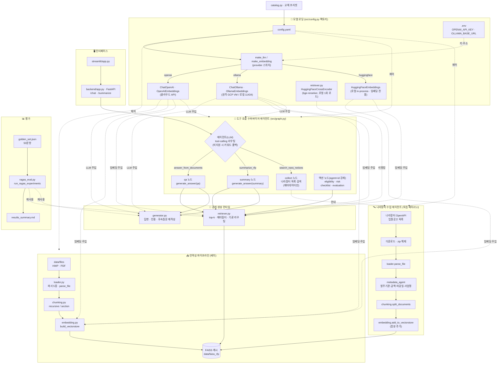
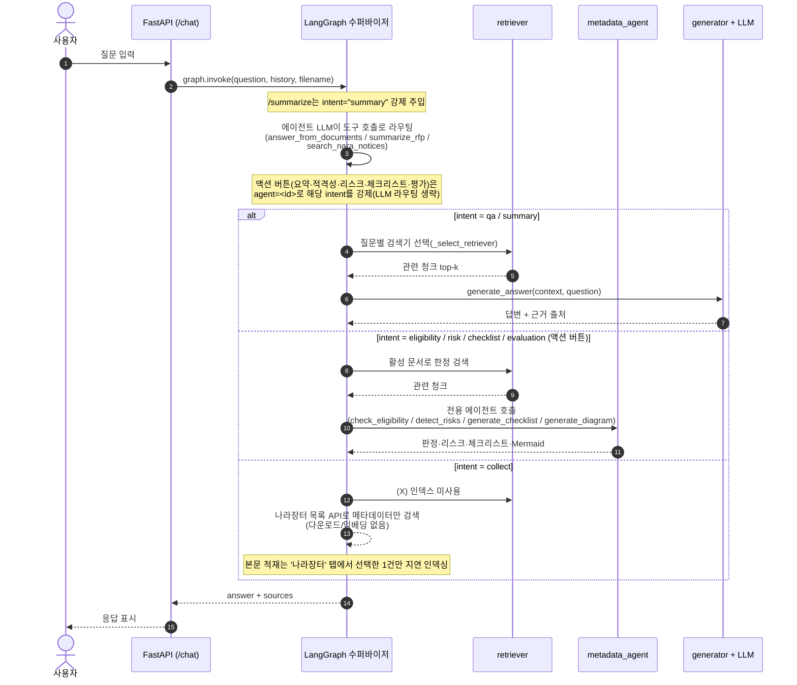
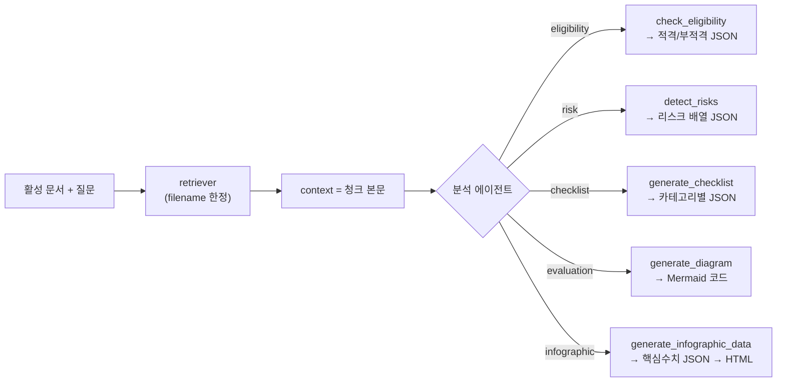

# 시스템 아키텍처

> 입찰메이트 — RFP RAG 질의응답 시스템 · 기준 브랜치 `limdongkyu`
> 💡 아래는 Mermaid 다이어그램 — GitHub·VS Code 미리보기에서 자동 렌더링됩니다.

## 전체 구조



## 질의응답 흐름 (LangGraph 라우팅)



## LLM·임베딩 모델 로딩 (어디서 불러오는가)

모든 모델은 **`src/config.py`의 두 팩토리 함수**를 거쳐 한곳에서 생성된다. 코드 어디에도
모델명을 하드코딩하지 않고, `config.yaml`(+ `catalog.py` 프리셋)의 `provider`/`model` 값으로
스위치한다. API 키·원격 주소는 `.env`에서만 읽는다(코드/깃에 키 없음).

| 만드는 곳 | 함수 | provider별 실제 객체 | 출처 |
|---|---|---|---|
| LLM | `make_llm(cfg)` | `openai`→`ChatOpenAI` · `ollama`→`ChatOllama` | `config.yaml`의 `llm:` 섹션 |
| 임베딩 | `make_embedding(cfg)` | `openai`→`OpenAIEmbeddings` · `ollama`→`OllamaEmbeddings` · `huggingface`→`HuggingFaceEmbeddings` | `config.yaml`의 `embedding:` 섹션 |
| 리랭커(별도) | `retriever._get_cross_encoder` | `HuggingFaceCrossEncoder`(sentence-transformers) | `retriever.reranker_model` (`BAAI/bge-reranker-v2-m3`) |

**provider별 모델이 실제로 어디서 오는지**

| provider | 모델 위치 | 필요한 .env | 비고 |
|---|---|---|---|
| `openai` | OpenAI 클라우드 API | `OPENAI_API_KEY`(필수) | 예: `gpt-5-nano`, `text-embedding-3-small` |
| `ollama` | 원격 Ollama 서버(GCP VM) 또는 로컬 `:11434` | `OLLAMA_BASE_URL`(또는 `config`의 `base_url`) | 주소 없으면 로컬 11434. 예: `qwen2.5:14b`, `bge-m3` |
| `huggingface` | 로컬 in-process(HF 캐시에서 가중치 로드, CUDA 있으면 GPU) | 없음 | 임베딩 전용. 예: `nlpai-lab/KURE-v1`, `BAAI/bge-m3` |

> `base_url`은 **ollama 전용**이다. config의 `base_url`을 우선, 없으면 `.env`의 `OLLAMA_BASE_URL`,
> 둘 다 없으면 로컬 11434를 쓴다. openai 호출에는 `base_url`을 넘기지 않는다(VM 주소가 남아 있어도
> 클라우드 호출이 깨지지 않도록).

**모델 주입 흐름(런타임 1개 공유):** `backend/app.py` `_rebuild()`가 부팅/설정변경 시
`make_llm`·`make_embedding`을 **한 번** 호출해 만든 객체를 `_STATE`에 담고, 그 **단일 LLM**을
`build_graph(cfg, llm, …)`로 그래프(라우팅 + 답변 생성)에 주입한다. 같은 LLM을 generator도 공유한다.

**팩토리를 호출하는 곳**

| 호출처 | 용도 |
|---|---|
| `backend/app.py · _rebuild` | 서비스용 LLM/임베딩 1개씩 생성 → 그래프에 주입(공유) |
| `src/agents/{metadata,risk,eligibility}_agent.py` | 각 에이전트가 필요 시 `make_llm(cfg)`로 자체 호출(단발 추출/판정) |
| `src/pipeline.py` · `scripts/dev/ask.py` | CLI/배치 파이프라인용 LLM·임베딩 |
| `src/evaluation` · `scripts/eval/*` | 평가용 **judge LLM**(별도 `JUDGE_LLM_PRESET`) + 의미유사도 임베딩 |
| `src/retriever.py` | 리랭커 CrossEncoder를 `make_llm`과 별개로 직접 로드(프로세스당 1회 캐시) |

## 컴포넌트 요약

| 레이어 | 파일 | 역할 |
|---|---|---|
| 설정 | `config.yaml`, `src/catalog.py` | 교체 축(임베딩·LLM·청킹·검색·파서) 스위치 + `nara` 섹션 |
| **모델 팩토리** | `src/config.py` | **`make_llm`/`make_embedding`로 provider별 LLM·임베딩 생성(.env에서 키·주소)** |
| 파싱 | `src/loader.py` | HWP(pyhwp·hwp-hwpx-parser·olefile) / PDF(pymupdf·pdfplumber) · `parse_file`(단일 파일) |
| 청킹 | `src/chunking.py` | recursive / section(키워드 섹션) |
| 임베딩 | `src/embedding.py` | FAISS 캐시(`build_vectorstore`) + 증분 추가(`add_to_vectorstore`) |
| 검색 | `src/retriever.py` | top-k + 메타데이터 필터 + 기관 자동 라우팅 |
| 생성 | `src/generator.py` | 답변 + 인용(citation) 정제 + 후속질문 재작성 |
| **에이전트** | `src/graph.py` | **도구 호출 수퍼바이저: LLM이 도구를 선택·호출해 라우팅** |
| **도구(tool)** | `metadata_agent`, `nara_agent`, `retriever`, `generator` | 에이전트가 호출하는 능력 — 메타데이터 추출 · 나라장터 검색 · 검색 · 답변생성 |
| 인터페이스 | `backend/app.py`, `src/streamlit/app.py` | FastAPI API · Streamlit UI |
| 평가 | `src/evaluation/ragas_eval.py`, `run_ragas_experiments.py` | 골든셋 18조합 RAGAS + 커스텀 지표 |

## 도구 호출 라우팅 (에이전트 + 도구)

수퍼바이저 **에이전트**(LLM)가 요청을 보고 **도구**를 하나 골라 호출한다. 도구 인자(검색어 등)도
LLM이 채운다. 도구 호출을 지원하지 않는 LLM(일부 Ollama)은 키워드 휴리스틱으로 폴백한다.
`/summarize`는 분류 없이 summary 도구를 강제한다.

| 도구(LLM에 노출) | 노드 | 동작(도구 본체) |
|---|---|---|
| `answer_from_documents(question)` | qa | 검색 → `generate_answer(qa)` |
| `summarize_rfp(query)` | summary | 검색 → `generate_answer(summary)` 고정 양식 |
| `search_nara_notices(keyword, days)` | collect | 목록 API로 메타데이터만 검색(인덱스 불변) |

> **메타데이터 추출은 더 이상 LLM 라우팅 도구가 아니다.** `metadata_agent`는 문서 업로드 시점
> (`/upload` → `append_metadata_row`)에 `data_list.csv`를 자동 기록하는 데 쓴다. 채팅에서는
> 노출하지 않는다.
>
> **에이전트 vs 도구**: `nara_agent`·`metadata_agent`는 결정적 파이프라인/단발 추출이라
> 그 자체로는 자율 에이전트가 아니라 **도구**다. 자율적 의사결정(어떤 도구를 쓸지)은
> 수퍼바이저 에이전트가 담당한다. 라우팅은 도구 호출 1회(전체 ReAct 루프 아님).

## 에이전트 액션 버튼 (레지스트리 + 챗 UI)

챗 UI(`src/streamlit/app.py`)는 AI 답변 아래에 **에이전트 액션 버튼**을 노출한다.
버튼 목록은 백엔드 `GET /agents`가 **레지스트리**(`src/agents/registry.py`)에서 내려준다.
버튼을 누르면 `POST /chat`에 `agent=<id>`가 실려, LLM 자동 라우팅 대신 해당 에이전트로
강제 분기한다(`/summarize`가 summary를 강제하는 것과 동일한 메커니즘).

- 분석 대상은 **현재 활성 문서 1건**이다. 사이드바에서 고른 문서(또는 업로드/나라장터로
  방금 인덱싱한 문서)의 `파일명`이 `/chat`의 `filename`으로 실려, `_select_retriever`가
  그 문서로 검색을 한정한다.
- 레지스트리 현황(모두 **구현 완료**, `implemented=True`):

  | 버튼 | id / intent | 본체 | 엔드포인트 |
  |---|---|---|---|
  | 요약 | `summary` | `generate_answer(summary)` | `/chat` |
  | 적격성 판정 | `eligibility` | `eligibility_agent.check_eligibility` (회사정보 멀티턴) | `/chat` |
  | 리스크 탐지 | `risk` | `risk_agent.detect_risks` | `/chat` |
  | 체크리스트 | `checklist` | `generator.generate_checklist` | `/chat` |
  | 평가 구조 | `evaluation` | `generator.generate_diagram`(Mermaid) | `/chat` |
  | 인포그래픽 | `infographic` | HTML 카드(구조화 출력) | **`/infographic`** |

- 대부분 버튼은 `/chat` + `agent=<id>`로 해당 graph intent를 강제한다. 인포그래픽만 텍스트가
  아닌 HTML 카드라 전용 `/infographic` 엔드포인트를 쓴다(레지스트리의 `endpoint`/`render`로 선언).

### 분석 에이전트 상세 (구현 내용)

5개 분석 에이전트는 공통적으로 **활성 문서 1건을 검색해 본문(context)을 모은 뒤 LLM에 넘겨
구조화 결과(JSON/Mermaid)를 받아** UI용으로 가공한다. 검색어는 각 노드가 질문에 키워드를 덧붙여
보강하고, 결과의 무결성을 위해 LLM 출력은 JSON 파싱 → 실패 시 안전 폴백(빈 결과/원문)을 거친다.



| 에이전트 | 본체 함수 | 입력 | 출력 구조 | UI 렌더 |
|---|---|---|---|---|
| **적격성 판정** | `eligibility_agent.check_eligibility` | 활성 문서 참가자격 본문 + **대화 히스토리(사용자 발화만)** | `{status, message, 충족/미충족/불확실_요건, company_info}` | 마크다운 텍스트 |
| **리스크 탐지** | `risk_agent.detect_risks` | 활성 문서 본문 | `[{항목, 내용, 유형, 심각도, 심각도_이유}]` | 심각도순 마크다운 |
| **체크리스트** | `generator.generate_checklist` | 활성 문서 본문 | `{title, categories:[{name, items:[{label, note}]}]}` | 카테고리별 체크박스 |
| **평가 구조(다이어그램)** | `generator.generate_diagram("evaluation")` | 활성 문서 본문 | ` ```mermaid ` 코드 블록(graph TD / mindmap) | Mermaid 자동 렌더 |
| **인포그래픽** | `generator.generate_infographic_data` → `render_infographic_html` | 활성 문서 본문 | `{title, agency, budget, deadline, evaluation_scores, key_requirements, …}` | HTML 카드(`/infographic`) |

**에이전트별 핵심 동작**

- **적격성 판정**(멀티턴): 2단계 LLM 호출이다. ① `extract_company_info`가 **사용자 발화에서만**
  회사정보(업종·규모·창업연수·매출액·직원수·인증)를 JSON으로 추출(어시스턴트의 RFP 답변을 회사정보로
  오인하지 않게). ② 업종·규모 중 하나라도 없으면 판정 대신 **부족 항목 안내**(`status=missing_info`)를
  돌려 추가 입력을 유도하고, 충분하면 RFP 자격요건과 대조해 `적격/부적격` + 충족/미충족/불확실 요건을 판정.
- **리스크 탐지**: 인증 요구·실적 요건·기술 요건·기업 규모·실격 조항 5유형을 탐지하고 각 항목에
  `심각도(높음/중간/낮음)`와 사유를 붙인다. `_normalize_item`이 허용값 밖의 유형/심각도를 보정하고,
  UI는 심각도순으로 정렬해 표시.
- **체크리스트**: 제출서류·참가자격·평가준비·일정확인 4카테고리로 `{label, note}` 항목을 추출. 문서에
  없는 카테고리는 빈 배열로 남긴다.
- **평가 구조**: `DIAGRAM_PROMPTS["evaluation"]`로 평가배점 구조를 **Mermaid 코드**로 생성한다. 답변에
  실린 ` ```mermaid ` 블록을 챗 UI가 그대로 렌더(별도 endpoint·이미지 변환 없음). `generate_diagram`은
  `gantt`·`eligibility` 타입도 지원하나 액션 버튼은 `evaluation`만 연결.
- **인포그래픽**: 본문에서 핵심 수치(기관·예산·마감·평가배점·핵심요구·자격요약)를 JSON으로 뽑아
  `render_infographic_html`로 한 장짜리 **HTML 카드**를 만든다. 텍스트가 아니라 `components.html`로
  인라인 렌더하므로 전용 `/infographic` 엔드포인트를 쓴다(Playwright/PNG 미사용). 파싱 실패 시
  `parse_error`로 원문을 돌려 빈 카드를 방지.

> 공통 안전장치: 모든 LLM 출력은 JSON/Mermaid로 파싱하며 실패 시 빈 결과·원문 폴백으로 처리해
> 잘못된 출력이 UI를 깨뜨리지 않게 한다. 적격성·리스크는 `metadata_agent` 형태의 단발 추출
> (`src/agents/*_agent.py`)이고, 체크리스트·평가·인포그래픽은 `generator` 안의 프롬프트 체인이다.

### 새 에이전트 추가 방법 (팀원 가이드)

에이전트 `X`를 추가하려면 세 곳만 손대면 UI 버튼·`/agents`·라우팅이 자동 연결된다.

1. **본체**: `src/agents/x_agent.py`에 처리 함수 작성(검색 → LLM 생성/추출).
   `metadata_agent.py`(단발 추출)나 `generator.generate_answer`(답변+출처) 형태를 참고.
2. **노드**: `src/graph.py`에 노드 `_x`와 조건 엣지 1줄(`{"x": "x"}`)을 추가하고,
   `_x`에서 1의 본체를 호출한다(다른 노드처럼 `state["filename"]` 기반 retriever 사용).
3. **등록**: `src/agents/registry.py`의 `X` 엔트리를 `implemented=True, intent="x"`로 갱신
   (또는 자기 모듈에서 `registry.register(AgentSpec(...))` 호출).

> 충돌 최소화: 공유 파일인 `registry.py`에서는 엔트리 1개만 만지고, 본체 로직은
> 자기 모듈(`x_agent.py`)과 graph 노드로 분리한다.

## 나라장터 (타겟 검색 + 지연 인덱싱)

전수 적재로 인덱스가 비대해지는 것을 막기 위해 **검색은 가볍게, 적재는 선택한 1건만** 한다.

| 단계 | 함수/엔드포인트 | 동작 |
|---|---|---|
| 검색(가벼움) | `nara_agent.search_notices` · `GET /nara/search` | 목록 API로 메타데이터만 조회·키워드 필터. 다운로드/임베딩 없음 → 인덱스 불변 |
| 지연 적재 | `nara_agent.ingest_notice` · `POST /nara/ingest` | 선택한 공고 1건만 첨부 다운로드→파싱→메타추출→FAISS 추가 |
| UI | Streamlit ‘나라장터’ 탭 | 키워드 검색 → 결과 목록 → 공고별 ‘인덱싱’ 버튼 |
| 배치(전체) | `python -m src.agents.nara_agent [YYYY-MM-DD] [--max N]` | 날짜 단위 일괄 수집(필요 시) |

- 환경변수 `NARA_API_KEY`(공공데이터포털 발급) 필요 — `.env`에 저장
- 산출물: `data/nara_seen.json`(중복 방지), `data/nara_downloads/`(첨부)
- 첨부 중복 제거: 같은 공고서가 hwp·pdf로 첨부되면(파일명이 달라도) **본문 내용 유사도**로 묶어 **HWP를 우선** 1개만 인덱싱(HWP 파싱 실패 시 PDF 폴백). 내용이 다른 문서(공고서·과업지시서 등)는 각각 유지
- 챗에서 "나라장터 …" 질문 → `collect` 분기가 `search_notices`로 메타데이터만 보여주고, 실제 본문 적재는 ‘나라장터’ 탭에서 고른 공고만 수행

## 교체 가능 부품 (catalog 프리셋)

| 축 | 옵션 |
|---|---|
| LLM | gpt-5-nano · gpt-5-mini · exaone3.5:7.8b(Ollama) · qwen2.5:14b(Ollama) |
| 임베딩 | OpenAI 3-small · KURE-v1(로컬) · BGE-M3(로컬) |
| 청킹 | recursive 300/500/1000 · section 500/1000 |
| 파서 | HWP: pyhwp·hwp-hwpx-parser·olefile / PDF: pymupdf·pdfplumber |
| 검색 | k, 메타데이터 필터, (옵션) BM25·리랭커 |
