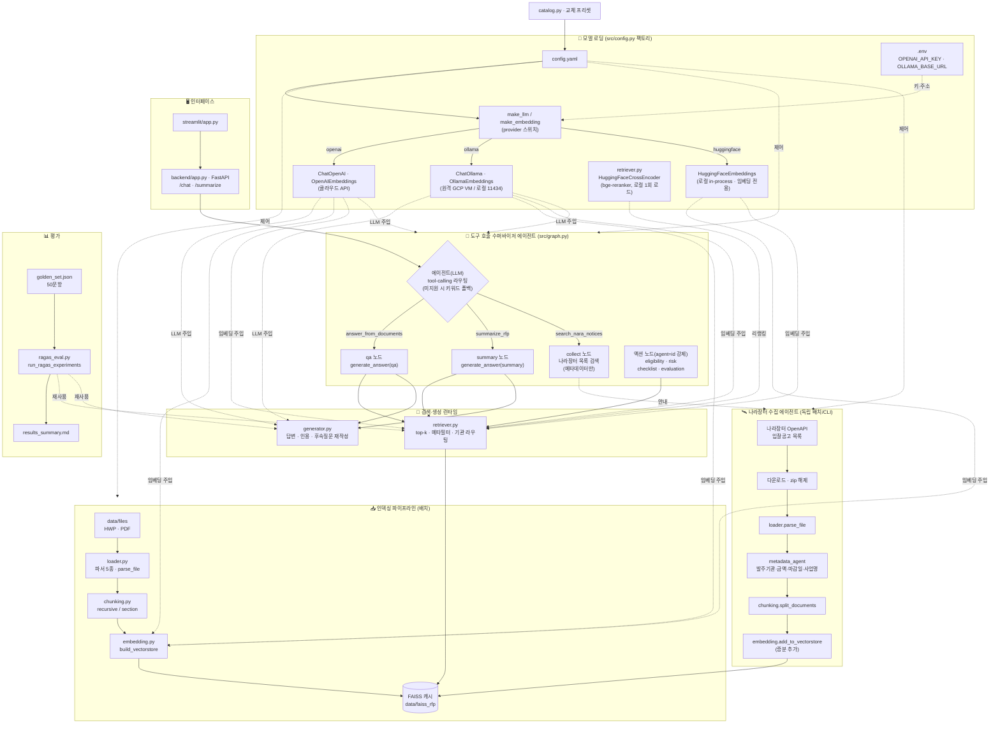

# 🤖 입찰메이트 — RFP RAG 질의응답 시스템

가상 B2G 입찰컨설팅 스타트업 **"입찰메이트"**의 사내 RAG(Retrieval-Augmented Generation) 시스템.
공공기관 RFP(제안요청서) 문서를 대상으로 QA·요약·분석 에이전트·나라장터 연동을 수행한다.
상세 설계는 `plan.md`, 시스템 아키텍처는 `ARCHITECTURE.md` 참고.

## 🎥 시연 영상

  [](https://youtu.be/vdpqzdG4k2I)


## 👥 팀 소개

| 프로필 | 이름 | 역할 | GitHub | 협업일지 |
| --- | --- | --- | --- | --- |
|  | 임동규 | Project Manager | [@Eastar0102](https://github.com/Eastar0102) | [협업일지][임동규] |
|  | 최혜리 | Data Engineer | [@twentycherry-gif](https://github.com/twentycherry-gif) | [협업일지][최혜리] |
|  | 안은남 | Retrieval Engineer | [@eunnamahn](https://github.com/eunnamahn) | [협업일지][안은남] |
|  | 김소원 | Generation, Prompt Engineer | [@ksw199777-hue](https://github.com/ksw199777-hue) | [협업일지][김소원] |
|  | 고귀한 | Test & Research | [@GwihanGo](https://github.com/GwihanGo) | [협업일지][고귀한] |

[임동규]: https://app.notion.com/p/1-_-_-38350973847880c9a70dcf39a8f8da26
[최혜리]: https://app.notion.com/p/_-395404be4d17802681a3fe32c952b44a
[안은남]: https://app.notion.com/p/3847dd05367b80ffb52afaff4df7dcfb?v=3847dd05367b8065b3f0000cd92e8f8a
[김소원]: https://app.notion.com/p/38420cc01e078040b1a7d3c768bd72cf
[고귀한]: https://pylog-record.tistory.com/category/%EC%A4%91%EA%B8%89%20%ED%94%84%EB%A1%9C%EC%A0%9D%ED%8A%B8

## 📓 보고서 & 발표자료
보고서: [입찰메이트_결과보고서.pdf](https://github.com/user-attachments/files/29692347/_.pdf)

발표자료: [코드잇part3_1팀_중급프로젝트_발표자료.pdf](https://github.com/user-attachments/files/29735804/part3_1._._.pdf)


## 1. 📌 프로젝트 개요

### 핵심 기능

- **QA**: "이 사업의 평가배점 기준은?" 같은 질문에 문서를 검색해 근거와 함께 답변
- **요약**: RFP 한 건의 예산·발주기관·마감일·핵심 요구사항을 정해진 양식으로 정리
- **분석 에이전트**: 적격성 판정, 리스크 탐지, 체크리스트 생성, 평가 구조 다이어그램, 인포그래픽
- **나라장터 연동**: 나라장터 OpenAPI에서 신규 공고를 검색·수집하고, 회사 프로필 기반으로 입찰 공고 추천

### 설계 원칙

- 베이스라인은 OpenAI API로 빠르게 구축한다.
- 교체 축(파서/청킹/임베딩/LLM/검색)은 전부 `config.yaml`과 팩토리 함수로 분리해 config 한두 줄 수정으로 갈아끼울 수 있다.
- 본문 소스로 메타데이터의 `텍스트` 컬럼을 쓰지 않고 원본 파일을 직접 재파싱한다.
- API 키는 코드에 하드코딩하지 않고 `.env`에서만 읽는다.

### 시스템 아키텍쳐 다이어그램



### 기술 스택

| 분류 | 기술 |
| --- | --- |
| 백엔드 | Python, FastAPI, LangChain, LangGraph |
| 벡터스토어 | FAISS |
| 문서 파싱 | HWP: pyhwp · hwp-hwpx-parser · olefile / PDF: PyMuPDF · pdfplumber |
| 검색 | rank-bm25(하이브리드) + BAAI/bge-reranker-v2-m3 |
| LLM / 임베딩 | OpenAI(gpt-5-nano/mini, text-embedding-3-small), 로컬(EXAONE·Qwen via Ollama, KURE-v1·bge-m3) |
| 프론트엔드 | React 18 + TypeScript + Vite, Zustand, TanStack Query, Tailwind CSS |
| 평가 | RAGAS + 커스텀 지표(Hit@k, MRR, 사실추출/거절 정확도, LLM 심판) |

## 2. ⚙️ 설치 및 실행 방법

### 설치

패키지는 한 줄씩 설치한다. (예시)

```
pip install langchain
pip install langchain-core
pip install langchain-community
pip install langchain-openai
pip install langchain-text-splitters
pip install faiss-cpu
pip install pandas
pip install pyyaml
pip install python-dotenv
pip install pdfplumber
pip install hwp-hwpx-parser
pip install rank-bm25
```

로컬 모델 실험 시에만 추가로:

```
pip install langchain-huggingface
pip install langchain-ollama
pip install sentence-transformers
```

### 환경 변수

프로젝트 루트에 `.env` 파일을 만들고 OpenAI와 나라장터 API 키를 넣는다(로컬 모델 연결이 없으면 설정에서 llm과 임베딩 모델을 OpenAi 모델로 교체해야함):

```
OPENAI_API_KEY=sk-...
NARA_API_KEY=...
```

### 실행

**1) 인덱싱 (최초 1회)**

```
python main.py
```

원본 100건을 파싱/임베딩해 FAISS 캐시(`data/faiss_rfp/<모델명>`)를 만든다.

**2) 베이스라인 평가**

```
python scripts/eval/run_baseline.py
```

검색(Hit@k, MRR), 메타추출 정확도, 거절 정확도를 출력한다.

**2-1) 실험 비교 (교체 축 한 바퀴)**

```
python scripts/eval/run_experiments.py            # 정의된 실험 전부
python scripts/eval/run_experiments.py --judge    # 서술형(judge_llm) 채점 포함
python scripts/eval/run_experiments.py --only baseline,chunk_1000
```

파서/청킹/임베딩/LLM/검색을 한 축씩 바꿔 같은 골든셋으로 채점하고 비교표를 출력한다.
같은 파서를 쓰는 실험은 원본 파싱을 1회만 수행해 재사용한다. (로컬 임베딩 KURE/bge 실험은 langchain-huggingface + sentence-transformers 설치 필요.)

**3) 풀스택 실행 (백엔드 + React 프론트엔드)**

```
python -m uvicorn backend.app:app --port 8000
cd frontend && npm install && npm run dev
```

FastAPI(기본 8000)와 Vite 개발 서버(기본 5173)를 각각 띄운다.

**3-1) 레거시 Streamlit UI**

```
./run.sh
```

React 전환 이전의 초기 개발/실험용 인터페이스. FastAPI(8000)와 Streamlit(8501)을 함께 띄운다.

> 참고: 사용 중인 OpenAI 키가 gpt-4o-mini에 접근 권한(RPM=0)이 없어 생성 LLM은 `gpt-5-nano`로 설정되어 있다(`config.yaml`의 `llm.model`).

### 데이터 준비 (실행 전 필요)

이 저장소에는 코드만 있고 데이터는 포함되어 있지 않다. 실행하려면:

1. `data/data_list.csv` (100건, 12컬럼)와 `data/files/`의 원본 HWP/PDF를 배치한다.
2. 골든셋을 실제 데이터에 맞게 생성한다(컨설턴트 4대 정보축 기준):
   ```
   python -m src.evaluation.build_golden --n 12 --body-n 6
   ```
   - metadata_extraction(대상 기관/예산/마감일)과 unanswerable은 자동 생성·자동 채점된다.
   - body_grounded(핵심 요구조건/제출 방식/평가 배점)는 본문을 보고 `answer`를 직접 채워 넣고, 채점하려면 `evaluate(..., judge_llm=...)`로 judge 모델을 넘긴다.

### 모델/임베딩/청킹 전환

프론트엔드 "설정" 패널(또는 Streamlit 사이드바)에서 LLM·임베딩·청킹 프리셋을 드롭다운으로 골라 적용하면 백엔드가 즉시 재조립한다. 임베딩/청킹을 바꾸면 재인덱싱이 필요할 수 있고(캐시가 있으면 즉시 전환), LLM 교체는 즉시 적용된다.

선택지를 추가하려면 `src/catalog.py`의 `LLM_PRESETS`/`EMBEDDING_PRESETS`/`CHUNK_PRESETS`에 항목 하나만 추가하면 된다(백엔드 `/config`와 프론트 드롭다운에 자동 반영). provider(openai/huggingface/ollama)가 아닌 완전히 새로운 종류를 추가할 때만 `src/config.py`의 팩토리도 함께 손본다.

`config.yaml`만 직접 수정해도 된다:

- HWP 파서: 기본 `parser.hwp: pyhwp`(빠름) / 표 마크다운 보존이 필요하면 `hwp-hwpx-parser`
- PDF 파서: 기본 `parser.pdf: pymupdf`(빠름/안정) / 표 정밀도가 필요하면 `pdfplumber`
- BM25 하이브리드: `retriever.use_bm25: true`
- 청크 크기: `chunk.size`, `chunk.overlap`
- 로컬 임베딩: `embedding.provider: huggingface`, `embedding.model: nlpai-lab/KURE-v1`
- 로컬 LLM: `llm.provider: ollama`, `llm.model: qwen3:8b`

## 3. 📂 프로젝트 구조

```
.
├── config.yaml              # 모든 교체 지점 설정
├── .env                     # OPENAI_API_KEY (직접 생성, gitignore)
├── data/
│   ├── data_list.csv        # 메타데이터 (직접 배치)
│   ├── files/                # 원본 HWP/PDF (직접 배치)
│   └── faiss_rfp/            # 벡터스토어 캐시 (자동 생성)
├── src/
│   ├── config.py             # config 로드 + 부품 팩토리
│   ├── loader.py             # 원본 파싱 + 전처리 + Document 변환
│   ├── chunking.py           # 청킹 전략
│   ├── embedding.py          # 임베딩 + FAISS 빌드/캐시
│   ├── retriever.py          # 검색기 (dense / hybrid / rerank)
│   ├── generator.py          # 프롬프트 + LLM 체인
│   ├── pipeline.py           # 전체 조립
│   ├── graph.py              # LangGraph 도구 호출 수퍼바이저 에이전트
│   ├── recommender.py        # 회사 프로필 기반 입찰 공고 추천
│   ├── infographic.py        # 평가 구조 인포그래픽 생성
│   ├── agents/                # 도구: metadata·nara·eligibility·risk agent
│   ├── streamlit/
│   │   └── app.py            # 레거시 Streamlit UI (React 전환 이전)
│   └── evaluation/            # 골든셋 채점 (ragas_eval, golden_set, ...)
├── backend/
│   └── app.py                # FastAPI 서버 (/chat /summarize /upload /nara/* 등)
├── frontend/                  # React + TypeScript + Vite 프론트엔드
│   └── src/
│       ├── pages/             # Chat · CompanySetup · Login · Register
│       ├── components/
│       ├── store/             # Zustand 상태 관리
│       └── api/
├── main.py                    # 인덱싱 엔트리포인트 (FAISS 저장)
├── scripts/                   # CLI 스크립트
│   ├── eval/                  # 평가 러너 (run_baseline·run_experiments·run_ragas_experiments)
│   ├── dev/                   # 수동 테스트 (ask·chat_ollama)
│   └── prebuild_index.py      # 인덱스 워밍업 (+ build_* 그리드)
├── experiments/                # 전처리/청킹 실험 노트북 및 결과
├── ARCHITECTURE.md             # 시스템 아키텍처 (Mermaid 다이어그램)
└── run.sh                     # 백엔드 + 레거시 프론트 동시 실행
```
